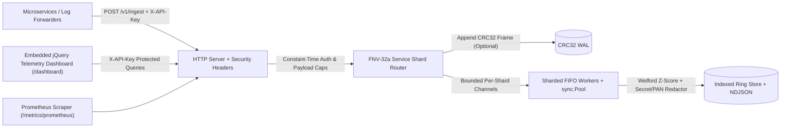

# High-Throughput Log Aggregation & Event Ingestion Pipeline (`v1.0.0`)

[](https://github.com/Chiru9030/high-throughput-log-pipeline/actions/workflows/ci.yml)
[](https://golang.org/)
[](Dockerfile)
[](k8s/statefulset.yaml)

A production-grade, concurrency-safe **Log Ingestion, WAL Recovery, PII Redaction, and Streaming Anomaly Detection Platform** engineered in **Go 1.24**. Features service-sharded FIFO worker channels, checkpointed CRC32 Write-Ahead Logging (WAL) with cold NDJSON tail hydration, `sync.Pool` slice reuse, Welford Z-score anomaly detection, SHA-256 constant-time API key authentication, Prometheus metrics, and a strict-CSP embedded jQuery observability UI.

---

## Architecture



### Key Production Capabilities
- **Deterministic Service-Sharded Concurrency (`internal/pipeline/pipeline.go`):** Events are hashed via FNV-32a by `service` name onto dedicated worker channels, guaranteeing strict per-service arrival order for Welford baseline tracking without cross-service lock contention.
- **Crash-Resilient Write-Ahead Log (`internal/wal/wal.go` + `cmd/pipeline/main.go`):** Length-prefixed binary WAL frames protected with `CRC32` checksums automatically replay on startup when `WAL_PATH` is set.
- **Multi-Format Parsing (`internal/parser/parser.go`):** Supports JSON payloads, **Syslog RFC 5424**, and **Logfmt** (`Content-Type: text/plain`).
- **Online Anomaly & PII Engine (`internal/anomaly/detector.go`):** Single-pass O(1) memory Welford Z-score latency outlier detection plus pre-WAL redaction of Bearer tokens, `token=`/`sk_live_` secrets, and Luhn-validated 13–16 digit payment PANs across `message`, `service`, `trace_id`, and `attributes` (with 10k-service cardinality caps).
- **Embedded jQuery Telemetry Dashboard (`internal/httpapi/ui/dashboard.html` + `ui/app.js`):** Strict-CSP dashboard (`script-src 'self' https://code.jquery.com`, jQuery SRI) served at `/` and `/dashboard` with real-time throughput KPIs, nearest-rank P99 latency display, anomaly filter, and live event ingestion tester.
- **Security & Observability:** `crypto/subtle.ConstantTimeCompare` auth (`X-API-Key` / `Authorization: Bearer`), security headers (`nosniff`, `DENY`), `/healthz`, `/readyz`, `/metrics`, and `/metrics/prometheus`.

---

## API Reference

| Method | Endpoint | Auth | Description |
| :--- | :--- | :--- | :--- |
| `GET` | `/`, `/dashboard` | Public Shell | Embedded jQuery Telemetry & Anomaly Dashboard UI |
| `GET` | `/health`, `/healthz` | Public | Kubernetes/Docker liveness probe |
| `GET` | `/readyz` | Public | Readiness probe reporting store counts and queue depth |
| `POST` | `/v1/ingest` | `INGEST_API_KEY` *(if set)* | Ingest JSON, Syslog RFC 5424, or Logfmt log event (max `256 KiB`) |
| `POST` | `/v1/ingest/batch` | `INGEST_API_KEY` *(if set)* | Ingest array of events (max `4 MiB`, sheds `429` under backpressure) |
| `GET` | `/v1/logs` | `INGEST_API_KEY` *(if set)* | Query indexed logs (`service`, `level`, `anomaly=true`, `limit`) |
| `GET` | `/v1/anomalies` | `INGEST_API_KEY` *(if set)* | Query flagged anomalies |
| `GET` | `/v1/metrics/latency` | `INGEST_API_KEY` *(if set)* | Sliding 1-minute P50, P90, P99, Avg, Max latency per service |
| `GET` | `/metrics` | `INGEST_API_KEY` *(if set)* | JSON pipeline and storage counters |
| `GET` | `/metrics/prometheus` | `INGEST_API_KEY` *(if set)* | Prometheus text exposition format (`0.0.4`) |

---

## Configuration (`.env.example`)

Copy [`.env.example`](.env.example) and export environment variables before running locally:

```bash
cp .env.example .env
set -a && source .env && set +a
```

- `LISTEN_ADDR` / `PORT` — HTTP bind address (`:8090` default) or PaaS port
- `NDJSON_PATH` — Append-only NDJSON archival file path (rehydrated tail up to capacity on reboot)
- `WAL_PATH` — Checkpointed binary CRC32 WAL file path (`<WAL_PATH>.ckpt`) with 4 MiB compaction threshold
- `INGEST_API_KEY` — Shared API key protecting `/v1/*` and `/metrics*` endpoints (hashed via SHA-256 constant-time comparison)

---

## Getting Started & Verification

### Local Execution & Race-Checked Test Suite
```bash
go vet ./...
go test -v -race -count=1 ./...
go run ./cmd/pipeline
```

Verified Go test suites (`tests/pipeline_test.go`, `tests/v2_pipeline_test.go`):
- **TestPipelineBatchingRedactionAndAnomalyDetection**: Sharded FIFO baseline warmup, Z-score latency outlier alerting, and secret redaction.
- **TestHTTPIngestAndBackpressure**: HTTP `202` batch ingest, anomaly query, and `413` oversized payload rejection.
- **TestSyslogAndLogfmtParsing**: RFC 5424 syslog and logfmt ingestion over `text/plain`.
- **TestWriteAheadLogCrashRecovery**, **TestWALReplayRecoveredOnBoot**, & **TestWALCorruptHeaderTruncatesSafelyAndRedactsSecret**: CRC32 WAL recovery, corrupt tail truncation, zero-OOM frame validation, pre-WAL redaction, and non-duplicating NDJSON replay.
- **TestPercentileAggregatorP50P90P99** & **TestMetricsLatencyEndpoint**: Bounded sliding-window percentile aggregation (global and per-service).
- **TestAuthSecurityHeadersDashboardAndPrometheus** & **TestConcurrentEnqueueAndShutdownNoPanic**: Constant-time API key enforcement, security headers, concurrency-safe shutdown, and Prometheus counters.
- **TestEdgeCasesZeroStddevGlobalLatencyValidationAndSyslogPRI**: Zero-variance latency spikes, global `/v1/metrics/latency`, input validation, `413` text limits, and RFC 5424 severity extraction.
- **TestV1ZeroCompromiseAuditRegressions**: Multi-field Luhn/secret redaction, client anomaly-spoofing cleanup, case-insensitive bearer auth, trailing-JSON/query rejection, multi-line logfmt splitting, RFC 5424 severity 7/`VERSION` checks, nearest-rank small-sample percentiles, WAL compaction without NDJSON duplication or post-WAL crash loss, and strict dashboard CSP.

---

## Deployment (Docker, Kubernetes, Cloud & VM)

### Docker & Docker Compose
```bash
docker build -t ghcr.io/chiru9030/high-throughput-log-pipeline:v1.0.0 .
INGEST_API_KEY="your_secret_key" docker compose up --build
```
The multi-stage [`Dockerfile`](Dockerfile) builds a stripped static binary and runs under unprivileged UID `10001` (`appuser`) with a dynamic `${PORT:-8090}` `/healthz` check.

### Kubernetes (`k8s/`)
Build (or load into your cluster, e.g. `docker-desktop` / `kind load docker-image`), then apply:
```bash
docker build -t ghcr.io/chiru9030/high-throughput-log-pipeline:v1.0.0 .
kubectl create secret generic log-pipeline-secrets --from-literal=INGEST_API_KEY="$(openssl rand -hex 24)"
kubectl apply -f k8s/configmap.yaml -f k8s/statefulset.yaml -f k8s/service.yaml
```
Deploys as a non-root `StatefulSet` with `PersistentVolumeClaim` (`ReadWriteOnce`, `1Gi`) for durable WAL/NDJSON persistence, CPU/Memory limits, and liveness/readiness HTTP probes.

### Render & Linux VM
- **Cloud (Render):** [`render.yaml`](render.yaml) provisions the containerized web service binding cleanly to `PORT` with auto-generated `INGEST_API_KEY`.
- **Linux VM (`systemd`):** Run [`deploy/vm/provision.sh`](deploy/vm/provision.sh) on Ubuntu/Debian hosts to compile, install under dedicated `logpipeline` system user, generate a `chmod 600` `/etc/log-pipeline.env` API key, and enable `log-pipeline.service`.
