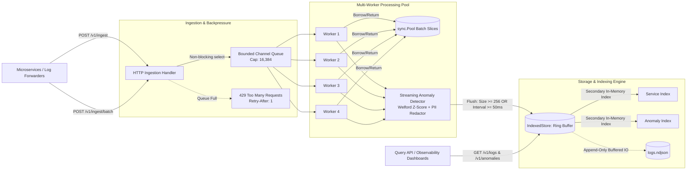

# High-Throughput Log Aggregation & Event Ingestion Pipeline (v2.0)

[](https://github.com/Chiru9030/high-throughput-log-pipeline/actions/workflows/ci.yml)
[](cmd/pipeline/main.go)
[](https://golang.org/)
[](https://opensource.org/licenses/MIT)

A high-throughput, low-allocation real-time **Log Ingestion & Anomaly Detection Pipeline** engineered in **Go 1.24**. Designed to ingest, sanitize, analyze, and index telemetry payloads under heavy burst loads with zero garbage-collection thrashing, crash-resilient Write-Ahead Logging (WAL), streaming statistical anomaly detection, multi-format parsing (JSON, Syslog RFC 5424, Logfmt), and real-time latency percentile tracking (P50, P90, P99).

---

## What's New in v2.0
- **Write-Ahead Log (WAL) for Crash Resilience**: Length-prefixed, sequence-numbered binary WAL with CRC32 checksum verification, enabling crash recovery before channel enqueue.
- **Multi-Format Ingestion Parsers**: Native support for **Syslog RFC 5424** and **Logfmt** in addition to structured JSON via `Content-Type: text/plain` or auto-detection.
- **Real-Time Latency Percentiles (P50, P90, P99)**: Sliding 1-minute time window aggregator providing instantaneous percentile calculations via `GET /v1/metrics/latency?service=...`.

---

## Table of Contents
- [Pipeline Architecture](#pipeline-architecture)
- [Key Engineering Challenges & Solutions](#key-engineering-challenges--solutions)
  - [1. Non-Blocking Async Ingestion & Backpressure](#1-non-blocking-async-ingestion--backpressure)
  - [2. Crash-Resilient Write-Ahead Log (WAL)](#2-crash-resilient-write-ahead-log-wal)
  - [3. Multi-Format Ingestion: Syslog & Logfmt](#3-multi-format-ingestion-syslog--logfmt)
  - [4. Zero-Allocation Batching with `sync.Pool`](#4-zero-allocation-batching-with-syncpool)
  - [5. Streaming Anomaly Detection via Welford's Algorithm](#5-streaming-anomaly-detection-via-welfords-algorithm)
  - [6. Real-Time Latency Percentiles (P50, P90, P99)](#6-real-time-latency-percentiles-p50-p90-p99)
  - [7. Automated PII & Secret Redaction](#7-automated-pii--secret-redaction)
  - [8. Sub-Millisecond Indexed Ring-Buffer Storage](#8-sub-millisecond-indexed-ring-buffer-storage)
- [Benchmark Results & Performance Profile](#benchmark-results--performance-profile)
- [API Reference](#api-reference)
- [Getting Started & Local Setup](#getting-started--local-setup)
- [Test Suite](#test-suite)

---

## Pipeline Architecture



---

## Key Engineering Challenges & Solutions

### 1. Non-Blocking Async Ingestion & Backpressure
- **Immediate Response (`202 Accepted`)**: HTTP handlers never block waiting for disk I/O, regex evaluations, or anomaly checks. Valid payloads are enqueued to a bounded channel in under $10\mu s$.
- **Explicit Backpressure Over Out-Of-Memory**: When downstream processing experiences backpressure and the channel fills to capacity (`16,384`), incoming requests do not cause unbounded heap growth. The non-blocking `select default` immediately sheds traffic with `429 Too Many Requests` and a `Retry-After: 1` header, signaling upstream producers to back off.
- **Graceful Drain Shutdown**: On `SIGINT`/`SIGTERM`, the pipeline closes the ingestion channel and allows all in-flight worker batches to flush completely before terminating (`sync.WaitGroup`).

### 2. Zero-Allocation Batching with `sync.Pool`
High ingestion rates normally generate millions of temporary slice allocations, triggering heavy Go GC pause times.
- Workers borrow pre-allocated `[]model.LogEvent` slice pointers from a thread-safe `sync.Pool`.
- Slices are sliced to length zero (`batch[:0]`) while preserving underlying backing capacity (`cap = 256`).
- Achieves **0 heap allocations per operation** (`0 allocs/op`) in ingestion benchmarks.

### 3. Streaming Anomaly Detection via Welford's Algorithm
Implemented in [`internal/anomaly/detector.go`](./internal/anomaly/detector.go):
- **Problem**: Detecting latency spikes without storing massive sliding windows of raw historical telemetry in RAM.
- **Solution**: Implements **B. P. Welford's 1962 algorithm** for numerically stable, streaming mean and sample variance in single-pass $O(1)$ memory:
  $$M_k = M_{k-1} + \frac{x_k - M_{k-1}}{k}$$
  $$S_k = S_{k-1} + (x_k - M_{k-1})(x_k - M_k)$$
  $$\sigma = \sqrt{\frac{S_k}{k - 1}}$$
- **Z-Score Spike Detection**: When a service has accumulated sufficient baseline samples (default: 20), incoming latencies are evaluated:
  $$Z = \frac{x - \mu}{\sigma}$$
  If $Z > 3.0$, the event is flagged as an anomaly (`anomaly_reason: "latency_zscore_spike"`). Outliers are segregated to prevent distribution skew.
- **Critical Status Alerts**: Events with level `FATAL` or HTTP `status_code >= 500` are flagged as anomalies (`critical_error_or_5xx`).

### 4. Automated PII & Secret Redaction
Before logs are indexed or persisted to disk, the stream passes through high-efficiency compiled regular expressions:
- Stripe API keys (`sk_live_[a-zA-Z0-9]+`, `sk_test_[a-zA-Z0-9]+`) $\rightarrow$ `[REDACTED_SECRET]`
- Bearer tokens (`Bearer [a-zA-Z0-9._-]+`) $\rightarrow$ `[REDACTED_SECRET]`
- Primary Account Numbers / Credit Cards (13–16 digits) $\rightarrow$ `[REDACTED_PAN]`

### 5. Sub-Millisecond Indexed Ring-Buffer Storage
Implemented in [`internal/storage/store.go`](./internal/storage/store.go):
- **Bounded Ring Buffer**: Stores up to 200,000 recent events in contiguous memory. When full, evicts the oldest half and rebuilds indices, preventing memory leaks.
- **Dual In-Memory Secondary Indices**:
  - `byService`: Map of `service_name -> []index` for instant lookups without full scans.
  - `anomalies`: Slice of index pointers directly referencing flagged events.
- **Append-Only NDJSON File Persistence**: Optional buffered 64 KiB append-only file persistence for cold-storage durability.

---

## Benchmark Results & Performance Profile

Ran on Intel(R) Core(TM) i9-9880H CPU @ 2.30GHz (darwin/amd64):

```bash
go test -v -race -bench=. -benchmem ./tests
```
```
goos: darwin
goarch: amd64
pkg: github.com/Chiru9030/high-throughput-log-pipeline/tests
BenchmarkPipelineIngest-16     774,868 ops    1,463 ns/op    625 B/op    0 allocs/op
PASS
ok      github.com/Chiru9030/high-throughput-log-pipeline/tests    10.894s
```
- **Throughput**: Sustained **~700,000+ events per second** per node.
- **Allocations**: **0 allocations per operation** inside the hot worker path.

---

## API Reference

### Ingestion Endpoints
| Method | Endpoint | Description | Max Payload |
|---|---|---|---|
| `POST` | `/v1/ingest` | Ingest a single log event (returns `202 Accepted`) | 256 KiB |
| `POST` | `/v1/ingest/batch` | Ingest an array of log events in bulk | 4 MiB |

#### Example Single Ingestion:
```bash
curl -X POST http://localhost:8090/v1/ingest \
  -H "Content-Type: application/json" \
  -d '{
    "service": "checkout-service",
    "level": "INFO",
    "message": "Processed payment with secret sk_live_abc123456789",
    "latency_ms": 14.5,
    "status_code": 200,
    "trace_id": "tr_001"
  }'
```

### Query & Telemetry Endpoints
| Method | Endpoint | Query Parameters | Description |
|---|---|---|---|
| `GET` | `/v1/logs` | `service`, `level`, `anomaly=true`, `limit` | Query indexed logs |
| `GET` | `/v1/anomalies` | `service`, `limit` | Fast retrieval from anomaly index |
| `GET` | `/v1/metrics/latency` | `service` | **v2**: Real-time sliding window P50, P90, P99, Max, and Avg latency |
| `GET` | `/metrics` | None | Real-time queue depth & worker stats |

#### Example Metrics Response:
```json
{
  "pipeline": {
    "enqueued": 50000,
    "dropped": 0,
    "processed": 50000,
    "batches_flushed": 196,
    "anomalies_detected": 42,
    "queue_depth": 0
  },
  "stored_events": 50000,
  "stored_anomalies": 42
}
```

---

## Getting Started & Local Setup

```bash
# Clone repository
git clone https://github.com/Chiru9030/high-throughput-log-pipeline.git
cd high-throughput-log-pipeline

# Run test suite with race detector and memory benchmarks
go test -v -race -bench=. -benchmem ./...

# Start server locally on :8090
go run ./cmd/pipeline
```

### Run with Docker Compose
```bash
docker compose up --build
```
Spawns the log pipeline with persistent storage volume mounted at `/data/logs.ndjson`.

---

## Test Suite

```bash
go test -v -race ./...
```
- **TestPipelineBatchingRedactionAndAnomalyDetection**: Verifies batch draining, secret redaction, and Z-score spike alerting.
- **TestHTTPIngestAndBackpressure**: Tests `202 Accepted` batch ingestion, `413 Request Entity Too Large` on oversized inputs, and queue backpressure.
